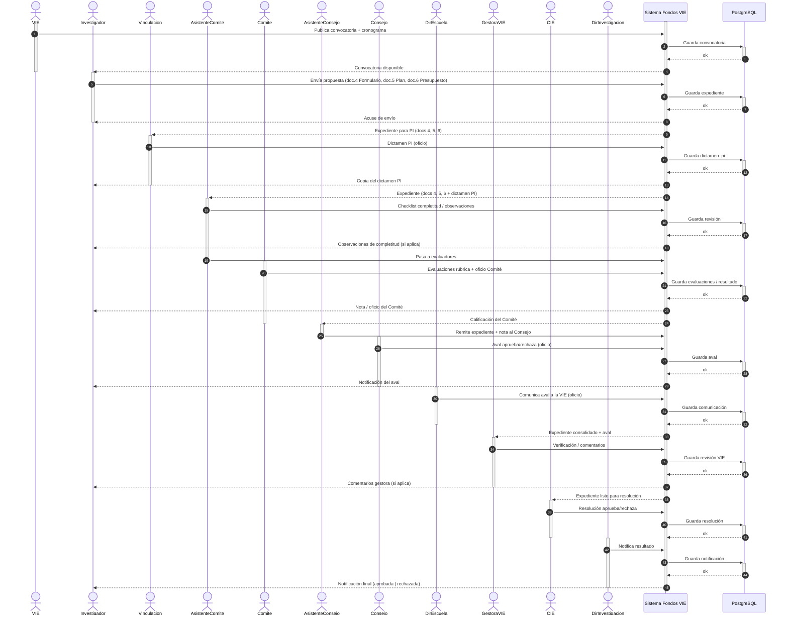

# Diagrama de secuencia — Proceso Fondos VIE

Vista de proceso (actores ↔ sistema). Documentos del expediente: **doc.4** Formulario, **doc.5** Plan/riesgos, **doc.6** Presupuesto.

Las **barras blancas** sobre cada línea de vida (activar / desactivar) marcan cuándo empieza y cuándo termina la participación de ese actor en el paso — es lo que el profe llama las “dos líneas” del foco de control.

### Notas

- **Activación:** la barra vertical en cada actor indica el tramo en que está “en el proceso”; al desactivar, termina su participación en ese paso (igual que en el ejemplo del juego con las cajas blancas).
- **Sistema** permanece activo de punta a punta; **PostgreSQL** se activa solo en cada guarda.
- Entre **( )** va el contenido concreto de esa flecha (docs 4/5/6, oficios, etc.).
- El investigador recibe: convocatoria, acuse, dictamen PI, observaciones, nota Comité, aval, comentarios gestora y resolución final.

### Exportar

Copiar el Mermaid a [mermaid.live](https://mermaid.live) → PNG/SVG.
