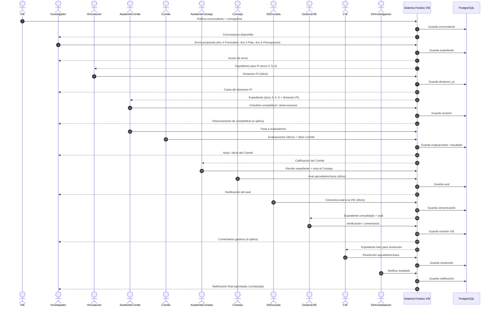

# Diagrama de secuencia — Proceso Fondos VIE

Vista de proceso (actores ↔ sistema). Documentos del expediente: **doc.4** Formulario, **doc.5** Plan/riesgos, **doc.6** Presupuesto.

### Notas

- Entre **( )** va el contenido concreto de esa flecha (docs 4/5/6, oficios, etc.).
- El investigador recibe: convocatoria, acuse, dictamen PI, observaciones, nota Comité, aval, comentarios gestora y resolución final.
- Las flechas `Sistema → PostgreSQL` son la conexión a la base de datos en cada persistencia.

### Exportar

Copiar el Mermaid a [mermaid.live](https://mermaid.live) → PNG/SVG.
