# Arquitectura de Información – Análisis de lo Existente

> Convertido desde PDF (12 páginas). Transcripción del texto + imagen de cada página para fidelidad visual.
> Carpeta de imágenes: `Arquitectura-de-Informacion-Analisis-de-lo-Existente_assets/`

---

## Página 1 — Portada

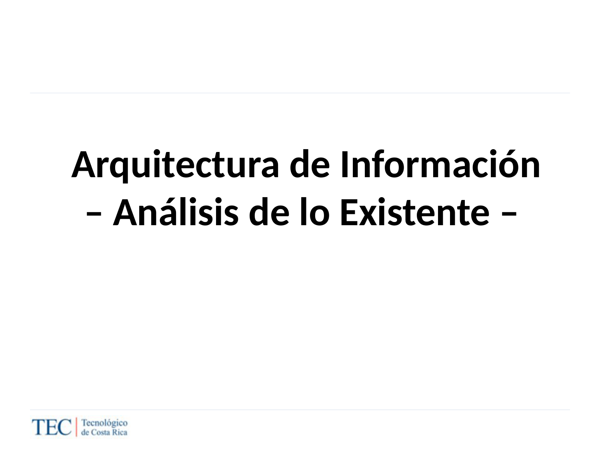

**Texto:**

- Arquitectura de Información
- – Análisis de lo Existente –

---

## Página 2 — Proceso general

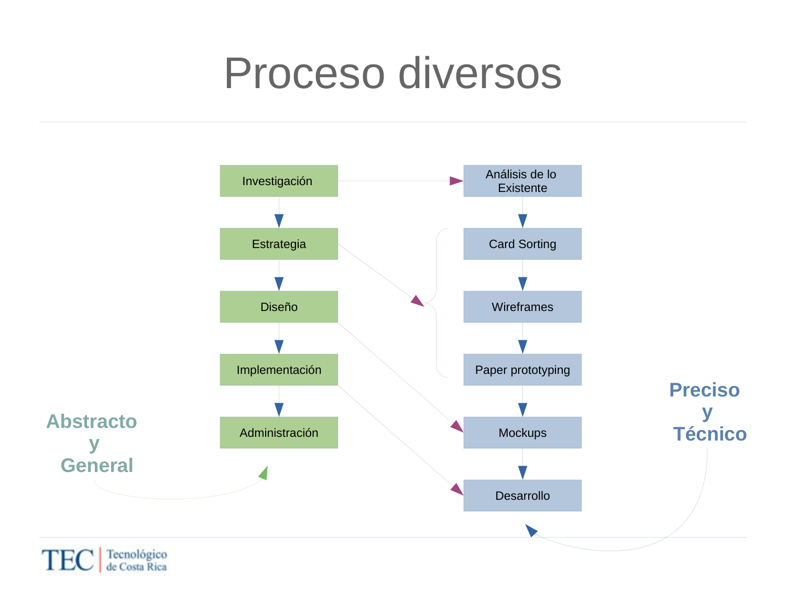

**Texto:**

- Proceso diversos
- Análisis de lo Existente · Card Sorting · Wireframes · Paper prototyping · Mockups · Desarrollo
- Columnas: Investigación · Estrategia · Diseño · Implementación · Administración
- Ejes: Abstracto y General → Preciso y Técnico

---

## Página 3 — Modelo general

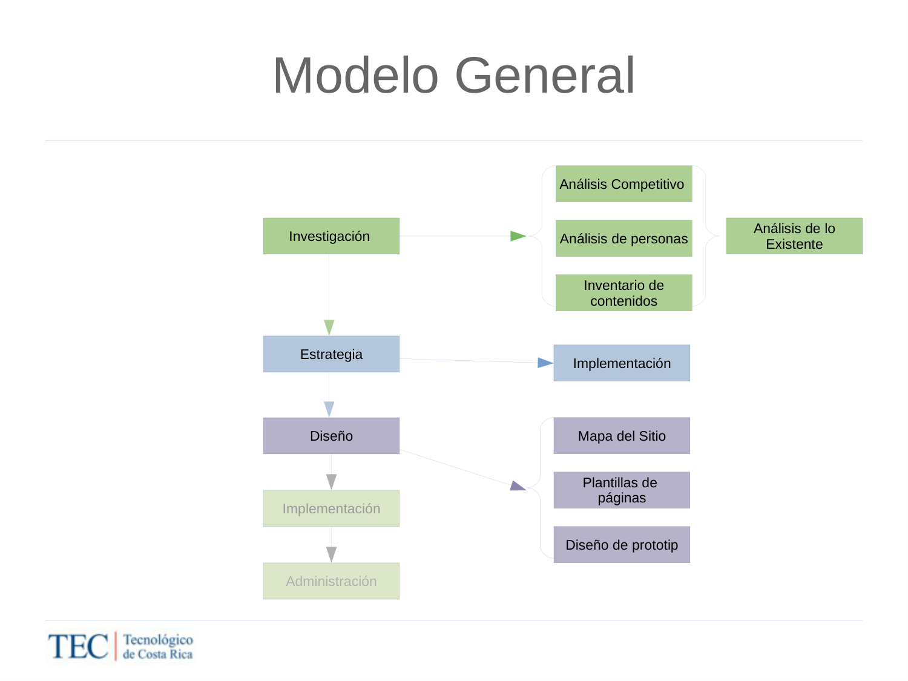

**Texto:**

- Modelo General
- Investigación: Análisis Competitivo, Análisis de personas, Inventario de contenidos, Análisis de lo Existente
- Implementación: Mapa del Sitio, Plantillas de páginas, Diseño de prototipo

---

## Página 4 — Análisis de lo Existente / Análisis Competitivo

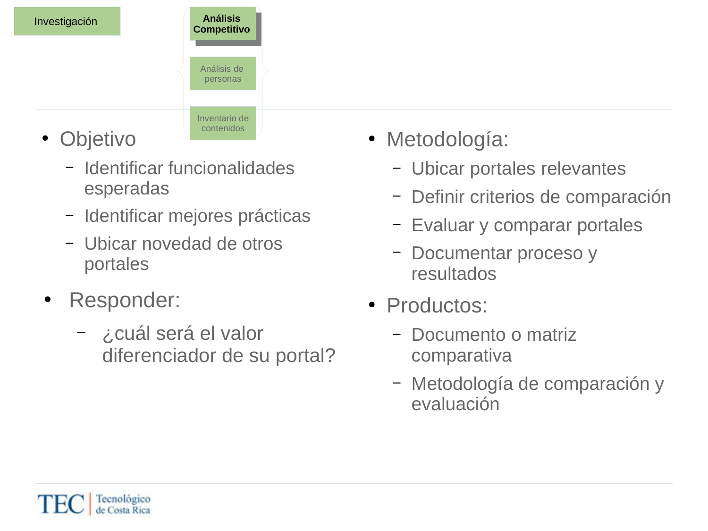

**Texto:**

- **Objetivo**
  - Identificar funcionalidades esperadas
  - Identificar mejores prácticas
  - Ubicar novedad de otros portales
- **Metodología**
  - Ubicar portales relevantes
  - Definir criterios de comparación
  - Evaluar y comparar portales
  - Documentar proceso y resultados
- **Productos**
  - Documento o matriz comparativa
  - Metodología de comparación y evaluación
- **Responder:** ¿cuál será el valor diferenciador de su portal?

---

## Página 5 — Ubicar portales relevantes

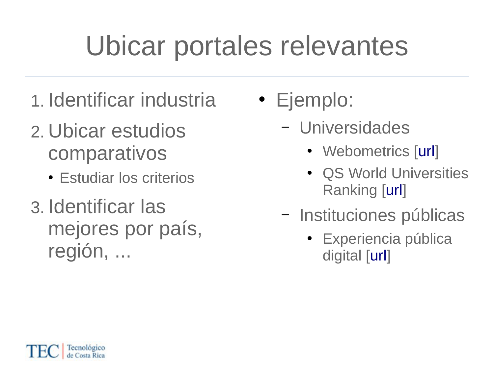

**Texto:**

1. Identificar industria
2. Ubicar estudios comparativos
   - Estudiar los criterios
3. Identificar las mejores por país, región, …
   - Ejemplo – Universidades: Webometrics, QS World Universities Ranking
   - Ejemplo – Instituciones públicas: Experiencia pública digital

---

## Página 6 — Criterios de comparación

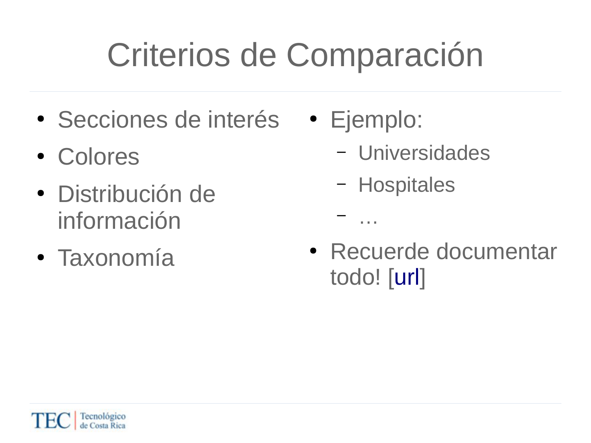

**Texto:**

- Secciones de interés
- Colores
- Distribución de información
- Taxonomía
- Ejemplo: Universidades, Hospitales, …
- ¡Recuerde documentar todo!

---

## Página 7 — Análisis de personas

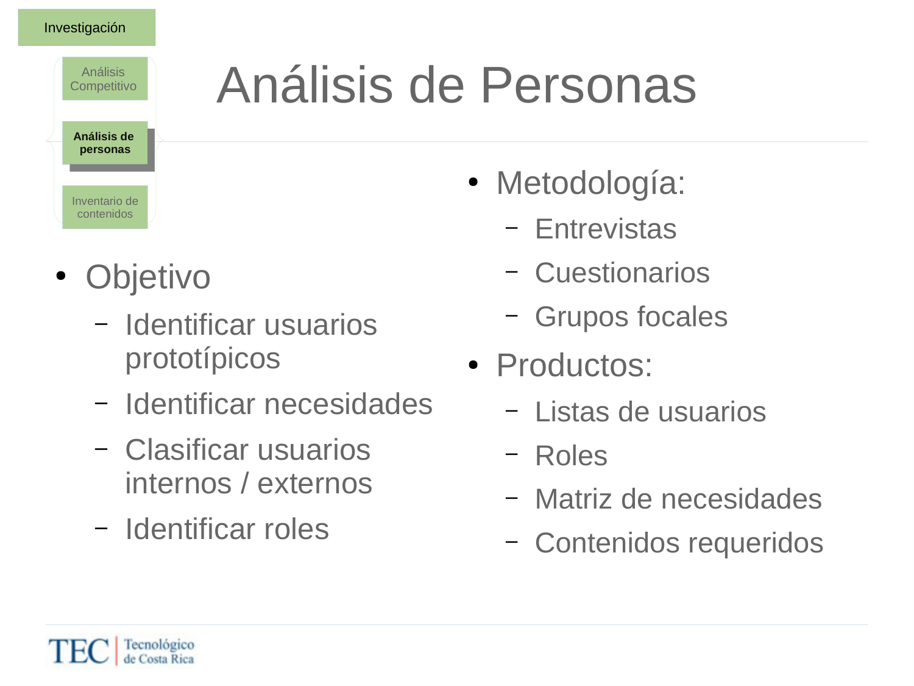

**Texto:**

- **Objetivo**
  - Identificar usuarios prototípicos
  - Identificar necesidades
  - Clasificar usuarios internos / externos
  - Identificar roles
- **Metodología:** Entrevistas, Cuestionarios, Grupos focales
- **Productos:** Listas de usuarios, Roles, Matriz de necesidades, Contenidos requeridos

---

## Página 8 — Análisis de personas / impactos (diagrama)

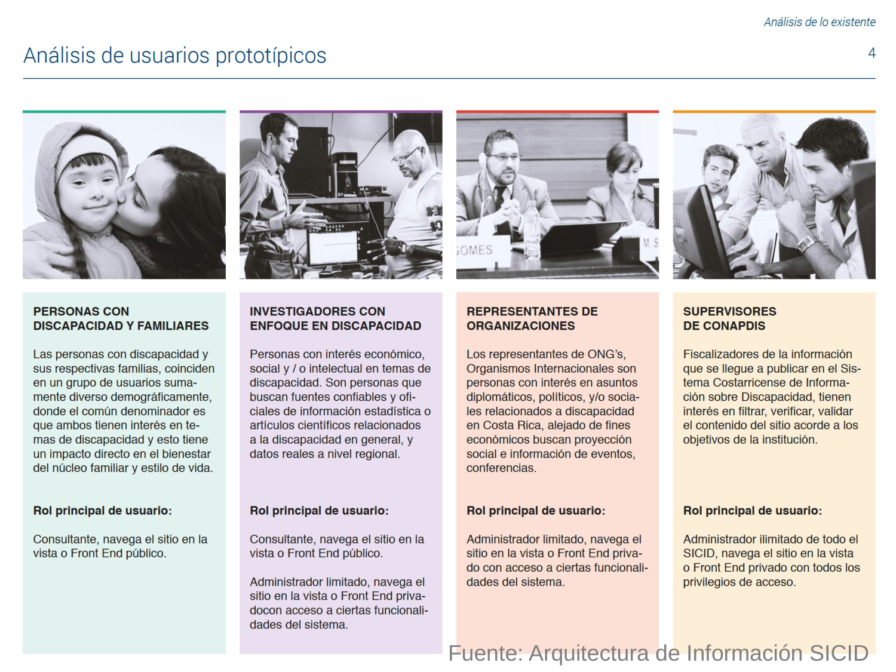

**Texto:**

- Fuente: Arquitectura de Información SICID
- (Diagrama / mapa mental — ver imagen)

---

## Página 9 — Análisis de personas: impactos

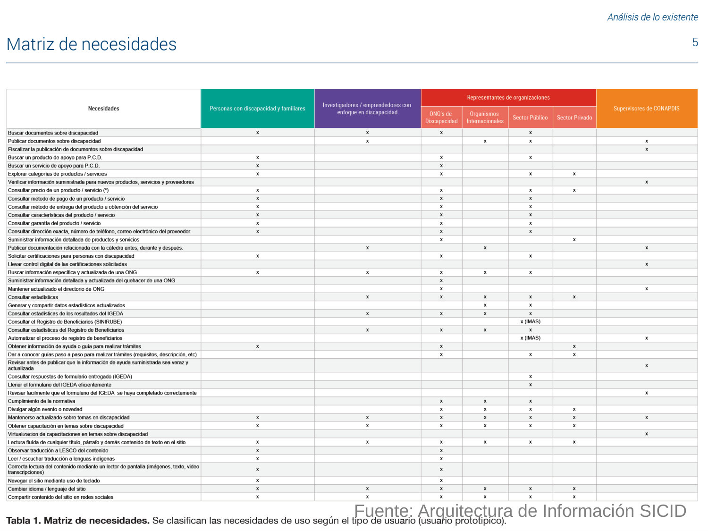

**Texto:**

- Mapa mental: Dirección, teléfono
- Gustos: Colores, Organización de elementos
- Cultura: Color, Posición de la mujer, Vestimenta
- Estados de ánimo: Fechas, Eventos (Nacionales, Internacionales)

---

## Página 10 — Inventario de contenidos

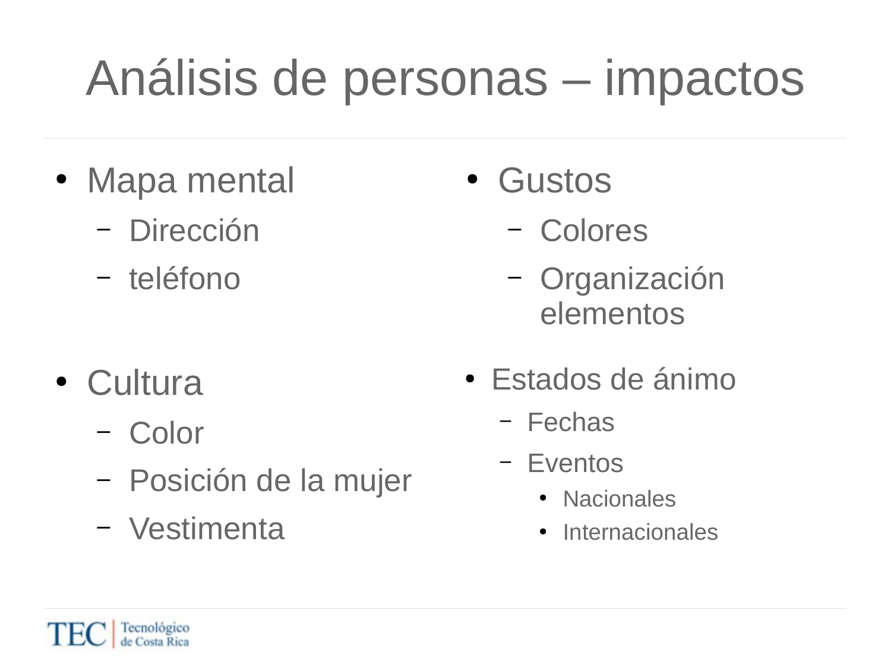

**Texto:**

- **Objetivo**
  - Identificar contenidos (información) requerida
  - Identificar información actual disponible
  - Identificar información nueva (disponible o no)
- **Metodología:** Análisis de usuarios prototípicos, Análisis de necesidades
- **Productos:** Inventario del sitio actual, Inventario del sitio nuevo (arquitectura beta)

---

## Páginas 11–12 — Cierre / fuentes

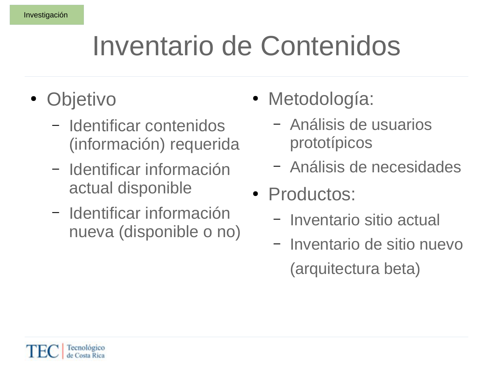

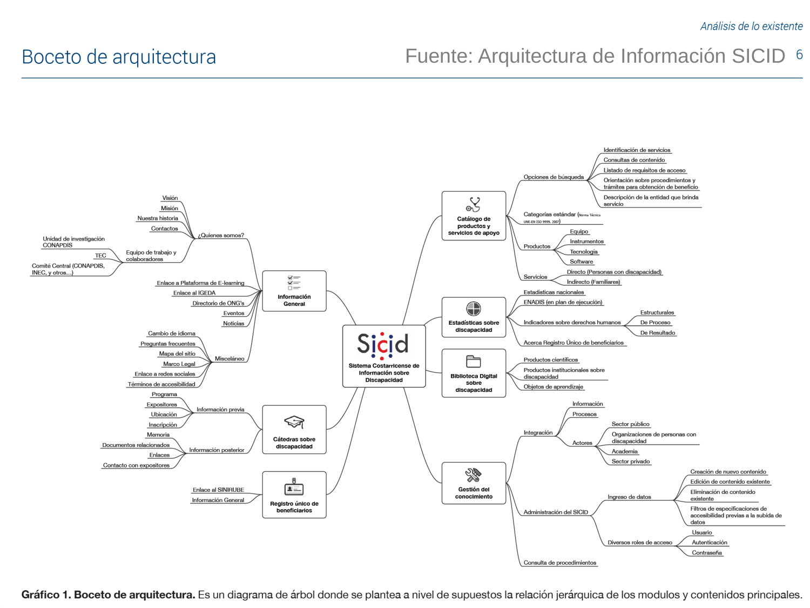

**Texto:**

- Fuente: Arquitectura de Información SICID
